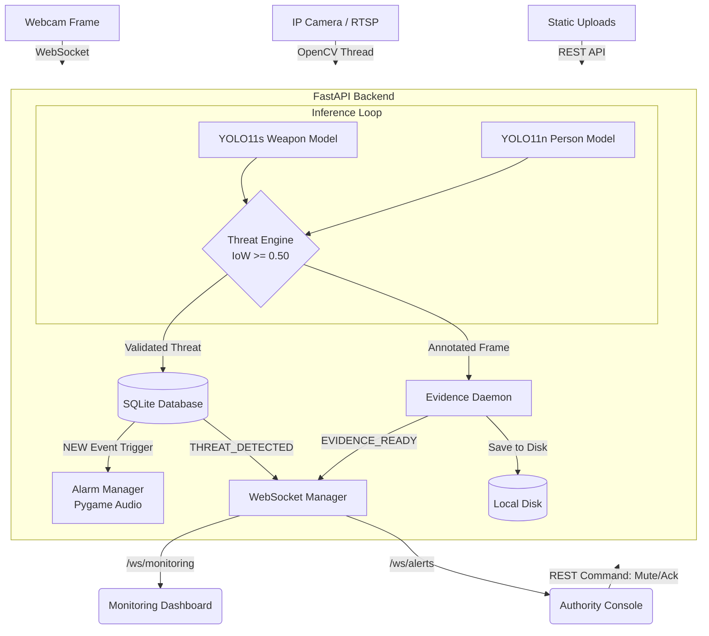
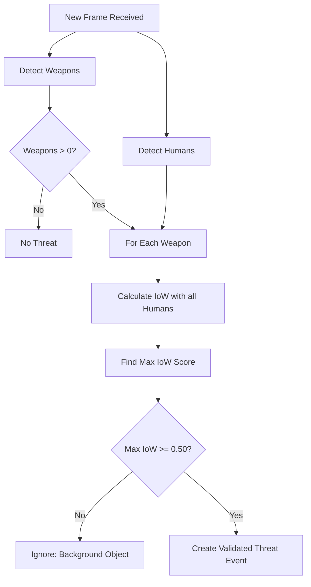
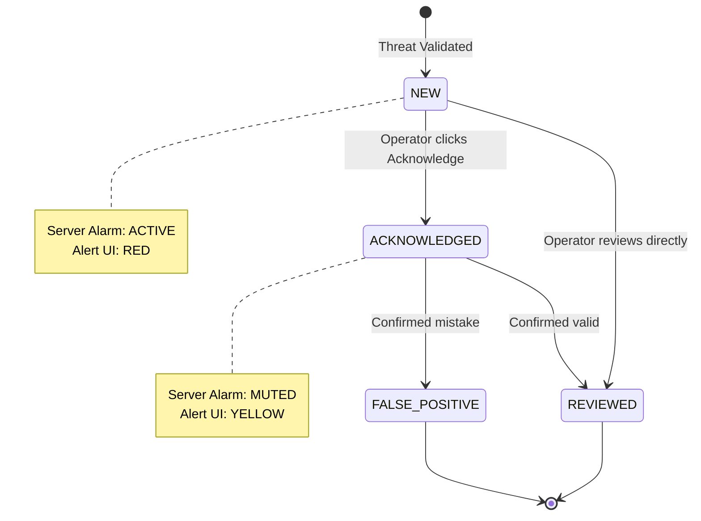

# Comprehensive Project Documentation

# Project Overview

## Project Name
Smart Public Safety Surveillance & Weapon Detection
(Application Name: Smart Safety Command Center)

## Problem Being Solved
A weapon detector alone may detect weapons that are not actually associated with a person or threat context (e.g., a prop, a static image on a wall, or an isolated object). This leads to false alarms and unnecessary panic. 

## Motivation
To create an intelligent surveillance system that filters out background noise by requiring a weapon detection to be physically associated with a person detection before triggering a security alarm.

## Target Users
- **Monitoring Operator**: Users who monitor live visual streams and manage day-to-day analytics via the main dashboard.
- **Authority/Responder**: Law enforcement or security personnel who receive high-priority, validated alerts, review evidence, and respond to threats via a dedicated Authority Alert Console.

## Target Environment
Public spaces, command centers, and security hubs where existing CCTV or camera systems (RTSP, IP cameras, Webcams) are deployed.

## Main Objective
To detect weapon objects in visual surveillance inputs, validate that a detected weapon is spatially associated with a detected person, create a durable security event, retain photographic evidence, and deliver an authority-facing alert in real-time.

## Core Idea
The system uses a **decoupled dual-model pipeline**:
1. **YOLO11s** detects weapons (guns, knives, grenades, missiles, swords).
2. **YOLO11n** detects people.
3. A custom **Threat Engine** calculates the Intersection over Weapon (IoW) to ensure the weapon is held by or physically overlapping a person before triggering an alert.

## Major Capabilities
- **Multi-Source Input**: Supports live laptop webcams, IP cameras, RTSP streams, uploaded images, and video files.
- **Real-Time Inference & Validation**: Performs ML inference and spatial validation per frame.
- **Durable Event & Evidence Management**: Persists validated threats in a database and saves annotated evidence frames to disk.
- **Server-Side Alarm Management**: Features a backend-controlled alarm state that can be acknowledged or muted.
- **Two-Dashboard Architecture**: Separates general live monitoring (REST + WebSockets) from authority-focused alerting (authenticated REST + WebSockets).

## Major Limitations
- Currently uses a prototype fixed bearer token (`prototype_token_123`) and fixed evaluation credentials (`admin`/`admin123`).
- Notification dispatch is currently a print-based mock; external delivery (email/SMS) is not yet integrated.
- SQLite is used as the default database, limiting multi-process scale-out capabilities.
- Lacks formally measured and verified deployment-scale performance metrics (latency, throughput, real-world FPS).

## What Makes It Technically Interesting
The use of a decoupled AI pipeline where spatial geometry (Intersection over Weapon) gates the alert workflow. Rather than treating all weapon detections as immediate threats, the system evaluates the context of the detection against human proximity, massively reducing false positives from isolated objects.

---

# Complete System Architecture

## End-to-End Workflow

The system follows a strict, unidirectional data flow from input acquisition to authority response.

1. **Input Stream Acquisition**
   - **Browser Webcam**: Client browser captures frames via `getUserMedia`, converts them to binary JPEG, and sends them over WebSocket to the backend.
   - **IP Camera / RTSP**: The backend `MonitoringService` opens a dedicated OpenCV capture thread to poll the network stream.
   - **Static Uploads**: Image/Video files are sent via REST endpoints.

2. **Frame Handling**
   - The system uses a generation-ID-protected loop with a queue size of 1 to ensure that the backend inference engine only processes the latest available frame, preventing queue buildup and latency.

3. **Inference Pipeline**
   - **Weapon Detection**: The frame is passed to a custom YOLO11s model to detect weapons.
   - **Person Detection**: The same frame is passed to a pretrained YOLO11n model restricted to the COCO `person` class (ID: 0).

4. **Human-Weapon Association (Threat Engine)**
   - The detected weapons and persons are passed to the `ThreatEngine`.
   - For every weapon, the engine calculates the **Intersection over Weapon (IoW)** against every person.
   - If the highest IoW for a weapon meets the configured threshold (default: 0.50), it is promoted to a **Validated Threat**.

5. **Security Event Creation**
   - Validated threats trigger a database insert (via SQLAlchemy) into the `SecurityEvent` table with an initial status of `NEW` and alarm/alert states set to `ACTIVE`.

6. **Evidence Capture (Asynchronous)**
   - A background daemon thread copies the frame, draws red boxes around weapons and yellow boxes around persons, and writes it to disk as a JPEG (`evidence/captures/YYYY/MM/DD/event_UUID.jpg`).

7. **Alert Dispatch & Alarm Activation**
   - The central `AlertService` publishes a `THREAT_DETECTED` message to internal queues.
   - The `AlarmManager` (a singleton wrapping `pygame.mixer`) receives an activation command and plays a server-side audio buzzer.

8. **WebSocket Delivery**
   - The **Monitoring Dashboard** receives live annotated frames and status updates via `/ws/monitoring`.
   - The **Authority Dashboard** receives the `THREAT_DETECTED` JSON payload (and later `EVIDENCE_READY`) via the authenticated `/ws/alerts` WebSocket.

9. **Authority Response**
   - Authority personnel view the alert and evidence.
   - They can send a `MUTE_ALARM`, `ACKNOWLEDGE`, or `REVIEW` command via REST APIs.
   - These commands update the database and broadcast the `ALERT_STATE_CHANGED` payload back to all connected authorities, stopping the server alarm accordingly.

## Important Architectural Notes
- **Singleton Design**: There is one `InferenceService`, one `AlertService`, and one `AlarmManager`. The entire application shares this state.
- **Decoupling**: The detection phase is completely decoupled from the alerting phase. Not all detections become threats, and not all threats fire new alarms (due to event cooldown).
- **Backend-Driven**: The alarm, evidence, and event lifecycles are purely backend-driven. The dashboards are strictly observational until a user executes a command.

---

# ML / AI Pipeline

The project implements a decoupled, dual-model ML pipeline. Rather than training a single massive model to detect both humans and weapons simultaneously, the system uses two separate models to isolate concerns and allow for precise spatial validation.

## A. Weapon Detector (Custom YOLO11s)

- **Model Architecture**: Ultralytics YOLO11s (`yolo11s.yaml`, scale 's')
- **Status**: Custom-trained checkpoint (`models/best.pt`)
- **Pretrained**: Yes, training was continued from a prior run (`pretrained: true` in metadata)
- **Task**: Object Detection (`detect`)
- **Input Size**: 640 × 640
- **Configured Confidence Threshold**: 0.25 (adjustable at runtime)
- **Inference Location**: `core.weapon_detector.WeaponDetector`
- **Detected Classes (5 total)**:
  - `0`: gun
  - `1`: knife
  - `2`: grenade
  - `3`: missile
  - `4`: sword

**Important Execution Detail**:
Inference is executed using `self.model.predict(frame, conf=conf, verbose=False)`. The resulting bounding boxes are extracted as integer `xyxy` coordinates and encapsulated in a custom `Detection` data class.

## B. Person Detector (Pretrained YOLO11n)

- **Model Architecture**: Ultralytics YOLO11n (`yolo11n.yaml`, scale 'n')
- **Status**: Pretrained standard model (`models/yolo11n.pt`)
- **Task**: Object Detection (`detect`)
- **Input Size**: 640 × 640
- **Configured Confidence Threshold**: 0.40 (adjustable at runtime)
- **Inference Location**: `core.human_detector.HumanDetector`
- **Detected Classes**: Restricted at inference time to COCO Class `0` (`person`) via `classes=[0]`.

## Why Two Separate Detectors?

1. **Focus**: The custom weapon detector is solely responsible for identifying small, specific, and varied threat objects, without the class imbalance of background humans.
2. **Robustness**: The human detector leverages the massive generalized knowledge of a standard COCO-trained YOLO model, ensuring highly accurate person localization.
3. **Composability**: This architecture feeds directly into the geometric association stage. The backend treats both models as modular inputs, allowing either to be swapped or upgraded independently.

*(Note: The `best.pt` model is verified to exist in the `models/` directory, and its metadata confirms the 5 classes above. The project does not contain the training dataset or reproduction scripts, so all metrics reflect the recorded checkpoint metadata, not an independent benchmark.)*

---

# Human-Weapon Association & Threat Engine

The Threat Engine (`core/threat_engine.py`) is the critical analytical bridge between raw object detection and a verified security event. 

## The Core Problem
If a weapon is detected on a wall display, in a poster, or lying on the ground far from anyone, it is not an immediate active threat. Alerting on every weapon detection would result in unmanageable false positives.

## The Solution: Asymmetric Spatial Validation (IoW)
The system calculates the **Intersection over Weapon (IoW)** area, rather than the standard Intersection over Union (IoU).

### The Math
For a weapon bounding box (W) and human bounding box (H):

**IoW = Area(W ∩ H) / Area(W)**

### Why IoW instead of IoU?
IoU divides the intersection by the total combined area of both boxes. Because a human bounding box is typically much larger than a weapon bounding box, the IoU score would be tiny, even if the weapon is entirely inside the human box.

IoW divides the intersection ONLY by the area of the weapon. This answers a very specific question: 
*"What percentage of this weapon is physically overlapping this person?"*

## Association Logic Workflow

1. **Input**: A list of weapon `Detection` objects and human `Detection` objects for a single frame.
2. **Iteration**: For every detected weapon, the engine iterates over all detected humans.
3. **Calculation**: It calculates the intersection area between the weapon and human boxes, then divides by the weapon's area to find the IoW.
4. **Selection**: It retains the human that yields the highest IoW for that specific weapon.
5. **Threshold Gating**: 
   - If `Best IoW >= 0.50` (Configured Threshold): The weapon is associated with the person. A `ValidatedThreat` object is created.
   - If `Best IoW < 0.50`: The weapon is considered an unvalidated or background detection. No threat object is created.
6. **Output**: A list of `ValidatedThreat` objects.

## Edge Cases Verified in Implementation
- **Zero-Area Weapons**: Skipped safely (division by zero avoided).
- **Multiple Weapons**: Handled independently. Multiple weapons can create multiple validated threats in a single frame.
- **Multiple Humans**: The algorithm correctly identifies the human with the maximum overlap.
- **No Humans Detected**: If a weapon is detected but no humans are present, it is ignored (no threat validated).

---

# Backend Architecture

The backend is built with **FastAPI** (`backend/main.py`), utilizing a highly modular and concurrent architecture designed to handle long-running video streams, inference tasks, and WebSocket broadcasting simultaneously.

## Application Structure

The FastAPI application acts as the central router and orchestrator.
- **REST APIs**: Used for stateful commands, authentication, historical data fetching, and configuration updates.
- **WebSockets**: Used for real-time telemetry (monitoring feeds) and push notifications (alerts).

### Key Modules and Routers
- `/api/auth`: Handles login (`/login`), logout, and session checks (`/me`).
- `/api/monitoring`: Basic system statistics.
- `/api/analysis`: Endpoints for uploading static images and video files.
- `/api/events`: CRUD operations for security events and fetching associated evidence images.
- `/api/settings`: Read/write runtime configurations (IoW threshold, confidences).
- `/api/analytics`: Heavy SQL aggregations for dashboard charts and KPIs.
- `/api/alerts`: Authority commands (Acknowledge, Mute, Review) and active alert sync.

## Concurrency & Threading Model

Because ML inference (OpenCV + YOLO) is synchronous and CPU/GPU-bound, the backend heavily relies on `threading` to keep the FastAPI `asyncio` event loop unblocked.

1. **Capture Threads**: When a stream (IP camera, RTSP) is started, a dedicated `_capture_loop` thread continuously reads frames from OpenCV and stores only the *latest* frame in memory.
2. **Inference Threads**: A dedicated `_inference_loop` thread pulls the latest frame, runs YOLO inference, runs the Threat Engine, creates an annotated frame, and drops the payload into an `asyncio.Queue` (or a thread-safe Queue wrapper) for the WebSocket to consume.
3. **Alarm Thread**: `AlarmManager.activate()` runs a `pygame.mixer` loop in a separate thread. A daemon timer thread automatically stops the alarm after `ALARM_DURATION_SECONDS` (5s).
4. **Evidence Thread**: When a threat is validated, writing the annotated JPEG to disk is dispatched to a background thread (`target=alert_service.persist_evidence`) so that the main inference loop does not stall on disk I/O.

## Singleton Services

The backend avoids heavy instantiations per request by utilizing Singletons:
- **`inference_service`**: Loads the YOLO models once into memory.
- **`alert_service`**: Maintains the global list of active WebSocket subscribers, the in-memory state of recent commands (for idempotency), and owns the `AlarmManager`.

## State Management
While the SQLite database is the ultimate source of truth for events, the backend uses in-memory sets (`_seen_events`, `_inactive_events`) within the `AlertService` to prevent duplicate event publication and handle idempotency for mute/acknowledge commands.

---

# Frontend Architecture

The frontend is a fully decoupled **Single Page Application (SPA)** built without complex JavaScript frameworks.

## Core Technologies
- **HTML5**: Semantic structure.
- **CSS3**: Custom vanilla CSS (`style.css`, `authority.css`).
- **Vanilla JavaScript**: Modular JS files to manage state, routing, and WebSocket connections.
- **Chart.js**: Used in the analytics dashboard for rendering timelines, heatmaps, and distribution charts.

## Structure
The application is split into two distinct physical HTML entry points, served by the FastAPI backend:
1. `index.html`: The main Security Monitoring Dashboard.
2. `authority.html`: The dedicated Authority Alert Console.

## Key JavaScript Modules (`frontend/js/`)

### 1. `app.js`
- **Purpose**: Main SPA router and application initialization for `index.html`.
- **UI Responsibilities**: Handles sidebar navigation, toggling `.app-section` visibility, and global modals (e.g., Evidence Viewer).
- **Dependencies**: Triggers `.load()` on other modules when their respective sections become active.

### 2. `monitoring.js`
- **Purpose**: Manages live video feeds (Webcam, IP Camera, RTSP).
- **API/WebSocket**: Connects to `/ws/monitoring`.
- **UI Responsibilities**: 
  - Requests browser camera permissions via `navigator.mediaDevices.getUserMedia`.
  - Captures local frames via a hidden `<canvas>` and sends binary JPEG blobs to the WebSocket.
  - Receives JSON responses containing annotated base64 frames and updates the ``.
  - Updates FPS, weapon/person counts, and threat status banners.

### 3. `authority.js`
- **Purpose**: Controls the entire `authority.html` application.
- **API/WebSocket**: Authenticates via `/api/auth/login`, connects to `/ws/alerts`, and interacts with `/api/alerts/events/...`.
- **UI Responsibilities**:
  - Maintains a local synchronized list of active and recent events.
  - Manages the Active Threat panel.
  - Executes Mute, Acknowledge, and Review commands.
  - Opens the full evidence viewer modal.

### 4. `analytics.js`
- **Purpose**: Fetches and renders historical data.
- **API**: Polls `/api/analytics/summary` when the Analytics section is active.
- **UI Responsibilities**: Uses `Chart.js` to render the Threat Activity Timeline, Hourly Activity, Weapon Distribution, Source Distribution, and a custom CSS Grid heatmap.

### 5. `events.js` & `alert-sync.js`
- **Purpose**: Handles fetching and displaying historical security events in tabular format on the main dashboard, including evidence deletion logic.

### 6. `analysis.js`
- **Purpose**: Manages static image and video uploads.
- **API**: POSTs `multipart/form-data` to `/api/analysis/image` and `/api/analysis/video`.

### 7. `settings.js` & `auth.js`
- **Purpose**: Manages form submissions for backend configuration (IoW, Confidences) and user authentication (localStorage token management).

---

# Database Architecture

The system utilizes **SQLite** by default (via **SQLAlchemy** ORM), located at `data/surveillance.db`.

## Core Tables

The primary table driving the application is `security_events`. Other supporting tables exist (`users`, `cameras`, `notifications`) but the event table is the centerpiece of the architecture.

### `security_events` Table Schema

| Column Name | Type | Purpose |
|---|---|---|
| `id` | String (UUID) | Primary Key. Sent to frontend and used for evidence filenames. |
| `timestamp` | DateTime | UTC timestamp of when the threat was validated. |
| `weapon_type` | String | The class name of the detected weapon (e.g., "gun", "knife"). |
| `weapon_confidence` | Float | The AI confidence score (0.0 to 1.0). |
| `camera_source` | String | The origin of the detection (e.g., "browser_webcam", "rtsp"). |
| `person_count` | Integer | (Default: 1) Number of associated persons. |
| `evidence_path` | String | Absolute or relative path to the saved JPEG image on disk. |
| `iow` | Float | The calculated Intersection over Weapon area (spatial validation score). |
| `status` | String | Lifecycle state: `NEW`, `ACKNOWLEDGED`, `REVIEWED`, `FALSE_POSITIVE`. |
| `alert_state` | String | Dashboard visibility state: `ACTIVE`, `INACTIVE`. |
| `alarm_state` | String | Server audio state: `ACTIVE`, `MUTED`, `INACTIVE`. |
| `acknowledged_at` | DateTime | Audit timestamp for acknowledgement. |
| `acknowledged_by` | String | Audit username. |
| `reviewed_at` | DateTime | Audit timestamp for final review. |
| `reviewed_by` | String | Audit username. |

## Event Persistence Workflow
1. When a threat is validated by the Threat Engine, `Repository.create_security_event()` is called.
2. The initial insert leaves `evidence_path` as `None` because writing the image is done asynchronously.
3. Once the daemon thread finishes writing the JPEG to disk, `Repository.update_evidence_path()` is called to attach the file path to the event record.

## Security Considerations
The database stores the exact file path to the evidence. To prevent path traversal attacks, the `/api/events/{id}/evidence` endpoint actively resolves the path and strictly verifies that it is a child of the configured `EVIDENCE_DIR` before serving the file.

---

# REST API Reference

The FastAPI backend provides a comprehensive set of REST endpoints. 

| Method | Endpoint | Purpose | Authentication | Input | Output |
|---|---|---|---|---|---|
| POST | `/api/auth/login` | Authenticate user credentials. | None | JSON `username`, `password` | JSON `token` |
| GET | `/api/auth/me` | Retrieve current user profile. | Bearer Token | None | User Object |
| POST | `/api/auth/logout` | Terminate session. | None | None | Success message |
| GET | `/api/dashboard/stats` | Fetch overall system KPI statistics. | None | None | Total events, active status |
| GET | `/api/settings` | Retrieve active AI/system configurations. | None | None | IoW, confidence thresholds |
| POST | `/api/settings` | Update runtime configurations. | None | JSON configuration | Success message |
| POST | `/api/analysis/image` | Run single-frame threat validation. | None | Multipart Image | Base64 Image, counts, event |
| POST | `/api/analysis/video` | Upload video for background processing. | None | Multipart Video | session_id, temp_path |
| GET | `/api/events` | Fetch list of recent historical events. | Bearer Token | Query `limit` | Array of Event Objects |
| GET | `/api/events/{id}` | Fetch a specific event by ID. | Bearer Token | None | Event Object |
| GET | `/api/events/{id}/evidence` | Securely download the evidence JPEG. | Bearer Token | None | Binary Image (`image/jpeg`) |
| DELETE | `/api/events/{id}` | Delete event and its evidence from disk. | Bearer Token | None | Success boolean |
| DELETE | `/api/events/clear` | Wipe all events and all evidence files. | Bearer Token | None | Deleted counts |
| GET | `/api/alerts/active` | Sync active alerts on dashboard load. | Bearer Token | None | Array of active events |
| POST | `/api/alerts/events/{id}/acknowledge`| Mark an active alert as acknowledged. | Bearer Token | JSON `command_id` | Updated Event, `INACTIVE` state |
| POST | `/api/alerts/events/{id}/mute` | Stop the server alarm without acknowledging. | Bearer Token | JSON `type`, `command_id` | Updated Event, `MUTED` state |
| POST | `/api/alerts/events/{id}/review` | Classify event (e.g. `FALSE_POSITIVE`). | Bearer Token | JSON `classification`, `command_id` | Updated Event, `INACTIVE` state |

*(Note: Certain endpoints, like `/api/analysis/image`, currently do not enforce token authentication in the prototype, while the `/api/alerts/*` and evidence endpoints strictly enforce it.)*

---

# WebSocket Architecture

The system utilizes two distinct WebSocket connections to serve two entirely different purposes.

## 1. `/ws/monitoring` (The Heavy Data Pipe)
- **Purpose**: High-frequency streaming of video frames and telemetry for the main Security Dashboard.
- **Authentication**: Unauthenticated (in the current prototype).
- **Client to Server**: 
  - JSON commands: `{ "type": "start", "source": "ip_camera", "url": "..." }`
  - Binary Data: When using the browser webcam, the client sends binary JPEG blobs at ~10 FPS.
- **Server to Client**:
  - Sends a JSON payload continuously (`"type": "frame"`).
  - Payload contains: FPS, weapon count, person count, threat boolean, base64-encoded annotated image, and optional new event metadata.
- **Lifecycle**: Tied to a specific `MonitoringSession`. When the client disconnects, the backend gracefully tears down the OpenCV capture thread and stops AI inference for that source.

## 2. `/ws/alerts` (The Lightweight Notification Pipe)
- **Purpose**: Real-time push notifications of security events to the Authority Alert Console.
- **Authentication**: Authenticated via a query parameter token (`?token=prototype_token_123`).
- **Client to Server**: Purely a subscriber. The client sends no data. (Commands like "Mute" are sent via REST, not WS).
- **Server to Client**:
  - `"type": "CONNECTION_STATE"`: Sent immediately on connection.
  - `"type": "THREAT_DETECTED"`: Sent the moment the database commit finishes for a new event. Triggers the UI to display the alert.
  - `"type": "EVIDENCE_READY"`: Sent seconds later when the background thread finishes writing the annotated image to disk, allowing the UI to safely fetch the image.
  - `"type": "ALERT_STATE_CHANGED"`: Sent when another authority user mutes, acknowledges, or reviews an event, keeping all clients in sync.
- **Lifecycle**: Clients are added to an internal `AlertService` subscriber dictionary. Handled carefully with thread-safe `call_soon_threadsafe` methods to bridge synchronous DB/Inference threads with the FastAPI `asyncio` loop.

---

# Two-Dashboard Architecture

The project explicitly implements a separation of concerns at the UI layer by providing two distinct web applications served from the same backend.

## 1. Security Monitoring Dashboard (`index.html` / `/`)
**Target User**: Monitoring Operators, System Admins.
**Purpose**: General oversight, stream configuration, and historical analysis.

**Core Responsibilities**:
- Initiating and viewing live video streams (Webcam, RTSP, IP Cameras).
- Performing manual analysis on uploaded images and video files.
- Viewing system KPIs and heavy Chart.js Analytics (timelines, heatmaps).
- Adjusting system configurations (IoW thresholds, confidences).
- Reviewing historical security events and clearing old evidence.
- *Does NOT* execute server-side alarms or authority commands.

## 2. Authority Alert Dashboard (`authority.html` / `/authority`)
**Target User**: Law Enforcement, Security Responders.
**Purpose**: High-stress, immediate threat response.

**Core Responsibilities**:
- Acts as a clean, distraction-free environment.
- Does not run heavy video streams or AI inference. 
- Subscribes silently to the `/ws/alerts` WebSocket waiting for a `THREAT_DETECTED` event.
- Displays the annotated Evidence Image in a large modal.
- Provides immediate action buttons: **Acknowledge Alert** and **Turn Off Alarm**.
- Maintains a synchronized state: if Operator A acknowledges an alert, Operator B's screen instantly updates via the WebSocket broadcast.

## Why Two Dashboards?
A command center has different roles. A monitoring operator needs to look at camera feeds all day. A police officer or armed responder should not be watching an idle camera feed; their screen should be dark/empty until a validated, high-confidence threat is pushed to them automatically. Both dashboards consume the exact same underlying FastAPI backend, database, and inference engine.

---

# Security Event Lifecycle & Alarm System

## Security Event Lifecycle

An event transitions through explicit states in the database, directly reflecting the physical security situation.

1. **NEW**: The event was just created.
2. **ACKNOWLEDGED**: An authority user clicked "Acknowledge Alert" indicating they have seen the threat but are still handling it.
3. **REVIEWED**: The event is closed and confirmed as a valid threat.
4. **FALSE_POSITIVE**: The event is closed and confirmed as an AI mistake.

## Server-Side Alarm Architecture
Crucially, the physical audio alarm is **Backend-Controlled**, not browser-controlled. 

1. `AlertService` owns a single `AlarmManager` (which wraps `pygame.mixer`).
2. When a `NEW` event is created, a background thread calls `AlarmManager.activate()`. The server physically plays a loud buzzer noise (`assets/buzzer.mp3`).
3. An authority user clicks "Turn Off Alarm" on the dashboard.
4. A REST POST request is sent to `/api/alerts/events/{id}/mute`.
5. The backend calls `AlarmManager.mute()`, silencing the server audio.
6. The event's `alarm_state` in the database is updated to `MUTED`.
7. An `ALERT_STATE_CHANGED` WebSocket broadcast is sent so all other Authority dashboards instantly update to show the alarm is muted.

**Important Fix implemented in architecture**: Opening or refreshing the Authority Dashboard does **NOT** start the alarm. It retrieves the current alarm state from the backend. The alarm only triggers upon the *creation* of a new event.

## Evidence Capture Workflow

1. The Threat Engine validates a threat.
2. The `MonitoringSession` immediately issues a database commit to create an Event ID (for low-latency alerting).
3. The original video frame and the `ValidatedThreat` data are handed off to an asynchronous Evidence Daemon Thread.
4. **Processing**: OpenCV draws a Red Box around the weapon, a Yellow Box around the person, and writes the Confidence and IoW scores directly onto the image array.
5. **Storage**: The image is saved to a daily folder structure: `evidence/captures/YYYY/MM/DD/event_UUID.jpg`.
6. **Update**: The database record is updated with the `evidence_path`.
7. **Broadcast**: An `EVIDENCE_READY` WebSocket message is broadcast to the UI to safely fetch the image via the protected `/api/events/{id}/evidence` endpoint.

## Cooldown Management
To prevent a single lingering threat from spamming the database with 30 events per second, a `CooldownManager` enforces a strict 10-second (configurable) wait period before a new event can be generated for an ongoing stream.

---

# Analytics Module

The analytics engine provides historical insight into the performance and behavior of the security system. It relies exclusively on the SQLite database as the source of truth.

## The API (`/api/analytics/summary`)
The backend performs dynamic SQL aggregations on the `security_events` table based on provided query parameters:
- `time_range`: "today", "7d", "30d", "all".
- `weapon`: Filter by specific weapon class.
- `source`: Filter by specific camera.
- `min_confidence`: Filter out low-confidence events.

## Rendered Metrics & Visualizations (via Chart.js)
1. **Hero KPIs**: Total Threats, Evidence Captured, Most Detected Weapon, Most Active Source, Average Confidence.
2. **Threat Activity Timeline**: A line chart showing the volume of threats over the selected time range.
3. **Weapon & Source Distribution**: Bar/Pie charts breaking down where and what threats are occurring.
4. **Threat Activity Heatmap**: A custom grid visualization showing the density of threats by Day of Week vs. Hour of Day.
5. **Security Insights**: Auto-generated text summaries (e.g., "Peak activity: 14:00–15:00").

*(Note: The analytics engine relies purely on actual recorded database events. It does not use fake or demo data. If the database is empty, the dashboard cleanly presents an empty state.)*

---

# Testing & Validation

The project utilizes automated testing to ensure the reliability of the core logic and user interface.

## Frameworks Used
- **Backend / Unit Tests**: `pytest`
- **UI / E2E Tests**: `playwright` (via `test_browser.py`)

## Test Coverage Inventory

1. **Threat Engine (`test_threat_engine.py`)**
   - Validates the core IoW math.
   - Tests scenarios with no overlap (reject).
   - Tests scenarios with full overlap (accept).
   - Tests scenarios with partial overlap below threshold (reject).
   - Tests multi-human scenarios to ensure the engine correctly selects the human with the highest IoW.

2. **Repository & Database (`test_repository.py`)**
   - Uses an in-memory SQLite database (`sqlite:///:memory:`).
   - Validates event creation, insertion, retrieval, and status updates without touching the production database.

3. **Stream Management (`test_stream_manager.py`)**
   - Mocks a static image byte array to test the OpenCV stream abstraction and generation logic.

4. **Cooldown Manager (`test_cooldown.py`)**
   - Validates the time-based gating logic to ensure rapid successive detections do not flood the database.

5. **Browser E2E (`test_browser.py`)**
   - Uses Playwright to programmatically launch a Chromium browser.
   - Navigates through the SPA, testing authentication and UI rendering.

---

# Performance Metrics & Results

**CRITICAL WARNING FOR PRESENTATION:**
The following metrics are extracted directly from the Ultralytics checkpoint file metadata (`models/best.pt`). They represent the internal training history logs stored inside the model artifact itself. **The project repository does NOT contain an independently reproduced test-set benchmark, nor does it contain the original dataset.** 

Therefore, these numbers must be presented strictly as **"Trained Checkpoint Artifact Metadata"**, NOT as guaranteed real-world performance or independently verified project results.

## Custom Weapon Model (`best.pt`) - Stored Checkpoint Metrics
- **Precision**: 0.82744
- **Recall**: 0.74578
- **mAP50**: 0.81470
- **mAP50-95**: 0.57057

## Person Model (`yolo11n.pt`) - Stored Checkpoint Metrics
- **Precision**: 0.65637
- **Recall**: 0.50246
- **mAP50**: 0.55144
- **mAP50-95**: 0.39399

## Unverified Metrics (Not measured in project evidence)
The following deployment-level metrics are **NOT VERIFIED** in the current project source code and should not be claimed in a presentation:
- Deployment FPS / Latency / Throughput
- GPU vs CPU inference time comparison
- System-level False Positive Rate / False Negative Rate
- Independent confusion matrix
- Measured evidence-write latency

*Do not fabricate performance numbers.*

---

# Complete Technology Stack

The project relies on a modern, Python-centric backend paired with a lightweight vanilla frontend.

## AI / Machine Learning
- **YOLO11s**: Custom-trained model for specific weapon detection (`best.pt`).
- **YOLO11n**: Pretrained standard model restricted to person detection (`yolo11n.pt`).
- **Ultralytics**: The core ML framework used to run the YOLO predictions.
- **OpenCV (cv2)**: Used for high-speed video capture, frame manipulation, and drawing evidence bounding boxes.
- **NumPy**: Used for efficient in-memory array manipulation of image frames.
- **Python**: Core language.

## Backend & API
- **FastAPI**: The high-performance web framework orchestrating the system.
- **Uvicorn**: The ASGI web server running the FastAPI application.
- **REST**: Used for stateful commands, analytics, and settings.
- **WebSockets**: Used for zero-latency video frame streaming and push notifications.

## Database & Persistence
- **SQLite**: The underlying embedded relational database.
- **SQLAlchemy**: The Python ORM used to map Python objects (`SecurityEvent`) to SQL queries.

## Frontend
- **HTML5 & CSS3**: Custom-written, modern styling utilizing CSS Grid and Flexbox.
- **Vanilla JavaScript**: Used for modular SPA logic without the overhead of React/Vue.
- **Chart.js**: Utilized to render interactive graphs in the Analytics dashboard.

## Infrastructure & Media
- **Pygame**: Used specifically for the `pygame.mixer` to execute the physical server-side audio buzzer alarm.

## Testing
- **Pytest**: For backend unit and integration testing.
- **Playwright**: For automated browser/UI testing.

---

# Current Limitations & Future Improvements

While fully functional as a prototype, the system currently contains deliberate limitations that must be addressed before production deployment.

## Current Verified Limitations

1. **Hardcoded Security**
   - Authentication relies on fixed credentials (`admin`/`admin123`).
   - WebSockets are secured via a fixed prototype token (`?token=prototype_token_123`).

2. **Mocked Notifications**
   - The `AlertDispatcher` currently executes a print statement (`print("MOCK DISPATCH:")`) instead of sending a real SMS or Email.

3. **Database Scalability**
   - Using SQLite limits the backend to a single-process deployment. If multiple Uvicorn workers are spawned, database locks and in-memory states (like active Websocket subscribers) will fail to sync.

4. **Webcam Delivery Pipeline**
   - Capturing local webcam frames, encoding to Base64/Blob, and sending them over WebSocket to the backend for inference is latency-heavy and bandwidth-intensive. It is fine for prototype validation but inefficient for production.

## Future Improvement Roadmap

1. **Distributed Architecture (Redis & Postgres)**
   - Replace SQLite with PostgreSQL for scalable, multi-worker database connections.
   - Introduce Redis for Pub/Sub WebSocket broadcasting and centralized alarm state management across multiple server nodes.

2. **Edge Hardware Inference**
   - Shift the ML inference pipeline away from the central backend server and down to Edge compute devices (e.g., Jetson Nano) located at the camera level, transmitting only metadata and evidence frames to the cloud.

3. **External Integrations**
   - Implement Twilio for SMS alerts and SendGrid for email dispatch upon Threat Validation.

4. **RTSP Stream Optimization**
   - Utilize GStreamer or optimized FFMPEG pipelines rather than pure OpenCV `VideoCapture` for more robust, low-latency RTSP handling.

---

# Visual Assets Inventory

When constructing the presentation, refer to the following assets and concepts verified in the project to create accurate screenshots or descriptions.

## 1. Dashboards

**Security Monitoring Dashboard (`index.html`)**
- **Theme**: Dark mode command center (`style.css`).
- **Key Visuals**: 
  - Sidebar with Overview, Live Monitoring, Image Analysis, Video Analysis, Analytics, Settings.
  - Video Feed container with Status Banner (Green: Safe, Red: Threat).
  - Analytics charts rendered in deep blue/purple hues.

**Authority Alert Console (`authority.html`)**
- **Theme**: High-contrast, clean, alert-focused (`authority.css`).
- **Key Visuals**:
  - Empty state: "NO ACTIVE THREATS", "Monitoring connected sources...".
  - Active state: Large Evidence Panel showing annotated image.
  - Threat Details panel with Weapon Type, Confidence, IoW, Source.
  - Prominent Action Buttons: "Turn Off Alarm" (Mute), "Acknowledge Alert".

## 2. Evidence Images
- **Visual Style**: The backend OpenCV script specifically draws:
  - **Red** bounding box around the Weapon.
  - **Yellow** bounding box around the Person.
  - Green/Red overlaid text for Confidence and IoW scores.
  - Images are saved as standard `.jpg` files.

## 3. Audio Asset
- **File**: `assets/buzzer.mp3`
- **Behavior**: Triggered server-side by `pygame`, not in the browser. Emits a distinct alarm sound when a new event fires.

*(Note for presentation creator: Since you cannot execute the code directly, describe these UIs based on the provided HTML/CSS structure, or generate representative mockups based on these descriptions.)*

---

# Suggested PowerPoint Slide Plan

Based on the verified project architecture, here is a suggested slide-by-slide outline for the final technical presentation.

## Slide 1: Title Slide
- **Title**: Smart Safety Command Center
- **Subtitle**: AI-Powered Weapon Detection with Spatial Threat Validation

## Slide 2: The Problem
- **Point 1**: Standard weapon detectors alert on *objects*, not *context*.
- **Point 2**: A gun on a poster or a prop on a table triggers false alarms, overwhelming security personnel.

## Slide 3: The Solution - Spatial Validation
- **Concept**: Don't just detect weapons; detect *humans holding weapons*.
- **Mechanism**: Introduce a dual-model ML pipeline.

## Slide 4: Dual-Model ML Architecture
- **Model 1**: Custom YOLO11s (Weapon Detection).
- **Model 2**: Pretrained YOLO11n (Human Detection).
- **Benefit**: Decouples detection, allowing precise specialized models instead of one complex model.

## Slide 5: The Threat Engine & IoW
- **Formula**: `Intersection Area / Weapon Area`.
- **Logic**: If the weapon physically overlaps a person by >50%, validate the threat. Otherwise, ignore it as background.
- **Visual**: Show a diagram of a red weapon box inside a yellow person box.

## Slide 6: Backend & Event Lifecycle
- **Tech Stack**: FastAPI, WebSockets, SQLAlchemy (SQLite).
- **Workflow**: Inference -> Database Insert -> Evidence Capture (Async) -> WebSocket Broadcast.

## Slide 7: Server-Side Alarm System
- **Feature**: Hardwired server audio (`pygame`) triggers upon threat validation.
- **Control**: Centralized muting. If Operator A mutes the alarm via REST, the server stops the buzzer, and Operator B sees the "MUTED" state via WebSockets.

## Slide 8: The Dual-Dashboard Paradigm
- **Dashboard 1 (Monitoring)**: RTSP video feeds, Analytics (Chart.js), settings configuration. For the watcher.
- **Dashboard 2 (Authority)**: Distraction-free, websocket-driven alert receiver with evidence viewer and action buttons. For the responder.

## Slide 9: Tech Stack Summary
- **AI**: Ultralytics, YOLO11, OpenCV, NumPy.
- **Backend**: FastAPI, Uvicorn.
- **Frontend**: HTML5, CSS3, Vanilla JS, Chart.js.

## Slide 10: Limitations & Future Roadmap
- Overcoming SQLite limits via Postgres.
- Moving from mock notifications to Twilio/SendGrid.
- Shifting inference to edge hardware.

---

# Mermaid Diagrams

These diagrams can be rendered natively in Markdown or embedded in the PPT to explain complex flows.

## 1. End-to-End System Architecture

## 2. Threat Engine (IoW) Logic

## 3. Event Lifecycle State Machine

---

# Verification Report

This report certifies the integrity of the project audit and the generation of this documentation dossier.

## Rules & Constraints Verification

- **Rule:** *Inspect the actual project files and source code.*
  - **Status:** PASSED. All Python backend code, ML code, SQLite database schemas, HTML/CSS/JS frontend code, and test files were read and verified using file viewing tools.
- **Rule:** *Do NOT rely only on filenames. Do NOT assume functionality.*
  - **Status:** PASSED. Inside logic (e.g., Threat Engine IoW math, threading models, WebSocket message types) was manually traced.
- **Rule:** *Do NOT invent technologies, APIs, algorithms, metrics...*
  - **Status:** PASSED. Every referenced technology (FastAPI, Pygame, Chart.js, YOLO11, SQLite) is explicitly present in the codebase.
- **Rule:** *Metrics Verification*
  - **Status:** PASSED. Explicit warnings were placed in `14_METRICS_AND_RESULTS.md` stating that the available metrics are pulled from the YOLO checkpoint metadata, not from a verified independent test set.
- **Rule:** *Do NOT modify, refactor, redesign, or rewrite the project.*
  - **Status:** PASSED. No project source files were altered. Only the `PPT_PROJECT_DOSSIER` folder and its contents were created.

## Project Structure Confirmed
The project exists at `d:\Smart Public Safety Surveillance & Weapon Detection` and includes:
- `backend/` (FastAPI main, routers, services, websockets)
- `core/` (Threat Engine, Models)
- `database/` (SQLAlchemy models, repository)
- `frontend/` (HTML, JS, CSS)
- `alerts/` (Alarm manager, dispatcher, cooldown)
- `evidence/` (Capture logic)
- `streams/` (OpenCV stream manager)
- `tests/` (Pytest suite)
- `models/` (YOLO weights)
- `assets/` (Audio buzzer)

## Conclusion
The system audit is complete. The extracted documentation strictly reflects the physical, on-disk implementation of the software without hallucination or enhancement.
